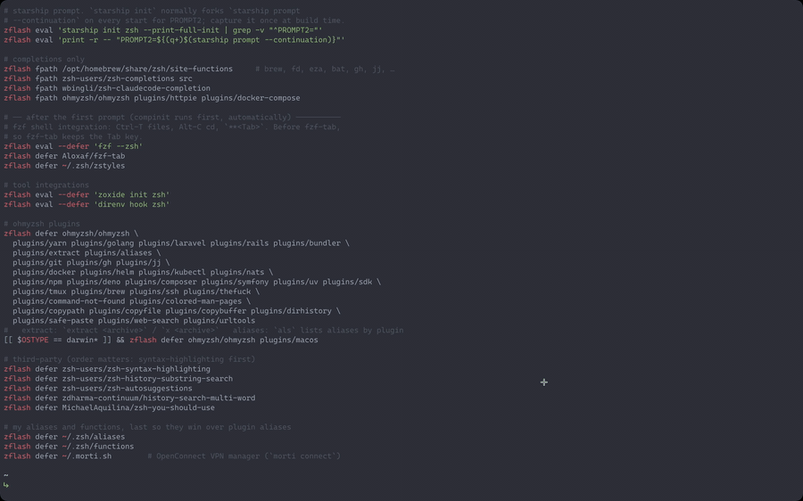
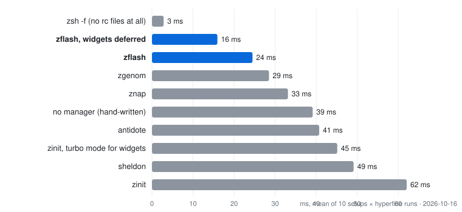

# zflash

A super blazing fast(est), staged zsh plugin manager.



zflash compiles a short declarative spec into one static, byte-compiled init
file. At shell start nothing is resolved, searched, forked or parsed by the
manager: your `.zshrc` sources a tiny bootstrap and that one file. Everything
in the spec, plugins, `<tool> init zsh` output and your own rc files, is split
into two stages, before and after the first prompt, so the prompt appears as
early as possible. compinit itself runs after the prompt.

## Why another one

| | typical manager | zflash |
|---|---|---|
| work at startup | load the manager, resolve plugins, maybe check for updates | source one compiled file |
| completion init | plugin-dependent, often a full `compinit` every start | cached `compinit -C` after the first prompt; earlier `compdef` calls are queued |
| deferred loading | add a plugin and wire it up yourself | `zflash defer`, built in (via romkatv/zsh-defer) |
| completion dirs | must be declared before compinit by hand | hoisted automatically from every line |
| `starship init zsh`, `zoxide init zsh`, `fzf --zsh` | forked on every start | run once at build time, output inlined (`zflash eval`) |
| your aliases, functions, exports | parsed on every start | listed in the spec: byte-compiled, staged like plugins |
| updates | at startup, in the foreground | in the background, after the prompt |

## Startup time

Same machine, same plugins (oh-my-zsh's lib, fzf-tab, zsh-completions, 39
oh-my-zsh and third-party plugins, 2 completion-only, starship, zoxide, direnv,
fzf), measured with `hyperfine -N 'zsh -i -c exit'` in Ghostty on an Apple
Silicon Mac, zsh 5.9. `zsh -f`, which reads no rc files at all, takes 2.2 ms.

| setup | startup |
|---|---|
| zgenom, the config I used before (everything loaded at startup) | 129 ms |
| zflash 0.1, plugins staged, the rest of `.zshrc` as it was | 32 ms |
| zflash 0.2, the whole `.zshrc` staged | **7 ms** |

What the last step changed, in order of effect:

- `starship init zsh` forks `starship prompt --continuation` on every start
  (4 ms); `zflash eval` captures the init once at build time.
- fzf-tab, the oh-my-zsh base library, zoxide, direnv and fzf are deferred
  past the first prompt, together with aliases and functions. compinit too.
- `~/.zshenv` sets `NO_GLOBAL_RCS`: macOS's `/etc/zshrc` forks `locale` and
  `/etc/zprofile` forks `path_helper` (3 ms). See
  [`examples/zshenv.zsh`](examples/zshenv.zsh).
- Every file zflash sources is byte-compiled, including plugin helper files
  and your own rc files.

The full config is in [`examples/`](examples/): [`plugins.zsh`](examples/plugins.zsh)
is the spec, [`zshrc.zsh`](examples/zshrc.zsh) the whole `.zshrc`.

## Benchmark

Six plugins (`zsh-completions`, `zsh-autosuggestions`, `zsh-syntax-highlighting`,
`zsh-history-substring-search`, oh-my-zsh `git` and `extract`) loaded through
seven setups, each using the manager's documented minimal configuration with
compinit where the manager's docs put it. Every shell runs with the same
scrubbed environment and its own `ZDOTDIR` and `HOME`. Each setup is first
checked, in a real pseudo-terminal, to have loaded all six plugins and
initialised completions; only then is it timed.

<picture>
  <source media="(prefers-color-scheme: dark)" srcset="bench/chart-dark.svg">
  
</picture>

| setup | mean | min |
|---|---:|---:|
| zsh -f (no rc files at all) | 2.8 ms ± 0.1 | 2.7 ms |
| zflash, widgets deferred | 15.9 ms ± 0.4 | 15.3 ms |
| zflash | 24.5 ms ± 0.6 | 23.6 ms |
| zgenom | 28.5 ms ± 0.6 | 27.5 ms |
| znap | 33.1 ms ± 0.5 | 32.2 ms |
| no manager (hand-written) | 39.2 ms ± 0.5 | 38.2 ms |
| antidote | 40.7 ms ± 0.7 | 39.5 ms |
| zinit, turbo mode for widgets | 45.1 ms ± 0.5 | 44.3 ms |
| sheldon | 49.1 ms ± 0.7 | 47.9 ms |
| zinit | 62.0 ms ± 0.6 | 60.6 ms |

Apple M4, macOS 27.0.1, zsh 5.9 (arm64-apple-darwin26.0), 2026-10-16. hyperfine, 10 setups, `zsh -i -c exit`.

Notes:

- *Deferred* rows load the three widget plugins (highlighting, autosuggestions,
  history search) after the first prompt: `zflash defer` and zinit's
  `wait lucid`. The zflash row also runs compinit after the prompt, its
  default whenever something is deferred. The other rows load everything
  before the prompt.
- zflash's lead over the hand-written setup comes from its cached compinit and
  byte-compiled files. The hand-written setup uses a plain `compinit` as most
  dotfiles do; with `compinit -C` it measures about 38 ms.
- zgenom uses `zgenom compdef`, antidote two bundle files with compinit between
  them, and sheldon an inline compinit plugin, because the oh-my-zsh git plugin
  calls `compdef` when sourced. zinit uses `zinit cdreplay`; znap runs compinit
  itself.
- Everything was cloned from local mirrors during setup; this has no effect on
  startup time.

Reproduce with:

```sh
zsh bench/run.zsh                       # needs git, hyperfine, python3; sheldon optional
ZBENCH_RUNS=50 zsh bench/run.zsh        # more runs
```

It writes `bench/results.json`, `bench/results.md` and the two charts.

## Install

From a checkout:

```sh
git clone https://github.com/arastu/zflash ~/Workspace/zflash
zsh ~/Workspace/zflash/install.sh --zshrc
```

Or in one line, which clones into `~/.local/share/zflash/zflash`:

```sh
zsh -c "$(curl -fsSL https://raw.githubusercontent.com/arastu/zflash/main/install.sh)" zflash-install --zshrc
```

This creates a spec at `~/.config/zflash/plugins.zsh` (a copy of
[`examples/starter.zsh`](examples/starter.zsh); edit it) and appends two lines
to `~/.zshrc`:

```zsh
source $HOME/Workspace/zflash/zflash.zsh
zflash boot $HOME/.config/zflash/plugins.zsh
```

Without `--zshrc` the installer prints the lines instead. The first shell you
open clones the plugins and builds the init.

## The spec file

The spec is plain zsh, evaluated only by `zflash build`, never at startup.

```zsh
# before the first prompt
zflash load  ~/.zsh/options                  # your own files work like plugins
zflash load  ~/.zsh/exports
zflash defer ohmyzsh/ohmyzsh                 # lib/*.zsh; history.zsh stays before the prompt
zflash eval  'starship init zsh --print-full-init | grep -v "^PROMPT2="'
zflash eval  'print -r -- "PROMPT2=${(q+)$(starship prompt --continuation)}"'

# completions only
zflash fpath /opt/homebrew/share/zsh/site-functions
zflash fpath zsh-users/zsh-completions src
zflash fpath ohmyzsh/ohmyzsh plugins/docker plugins/httpie

# after the first prompt (compinit runs first, automatically)
zflash eval --defer 'fzf --zsh'
zflash defer Aloxaf/fzf-tab
zflash eval --defer 'zoxide init zsh'
zflash defer ohmyzsh/ohmyzsh plugins/git plugins/extract plugins/kubectl
zflash defer zsh-users/zsh-syntax-highlighting
zflash defer zsh-users/zsh-autosuggestions
zflash defer ~/.zsh/aliases                  # last, so they win over plugin aliases
zflash defer ~/.zsh/functions
```

| verb | effect |
|---|---|
| `zflash load <repo> [path ...]` | source synchronously, before the first prompt |
| `zflash defer <repo> [path ...]` | source after the first prompt, in order |
| `zflash fpath <repo> [path ...]` | add the directories to `fpath` only |
| `zflash eval [--defer] '<cmd>'` | run `<cmd>` at build time and inline its output, in the given stage |

`<repo>` is `owner/repo` (cloned from GitHub, or `$ZFLASH_GIT_HOST`), a git URL,
or a local path: a directory, or a single file such as `~/.zsh/aliases`.
`[path]` is a file or directory inside the repo; with no path the repo root is
used. The plugin file in a directory is found automatically (`*.plugin.zsh`,
`init.zsh`, `*.zsh-theme`, `*.zsh`, `*.sh`).

**Your own files.** Anything you would `source` from `.zshrc` can be a spec
line instead, so it is staged and byte-compiled like a plugin. Files outside
the repository directory are recompiled on the fly whenever they are newer
than their `.zwc`, so edits take effect in the next shell. Put options and
exports in `load`; aliases and functions can almost always be `defer`.

**`zflash eval`.** `eval "$(starship init zsh)"`, `zoxide init zsh`,
`direnv hook zsh`, `fzf --zsh` and friends fork a process on every start to
print the same text. `zflash eval '<cmd>'` runs the command once, at build
time, and inlines the output into the init. The command is evaluated by zsh,
so pipes work; starship's init contains a second fork (`PROMPT2`), which the
two lines above capture at build time as well. Run `zflash build` after
upgrading a tool, or wait for the next background update.

**Completions.** Any directory containing `_*` completion files, including
`functions/`, `completions/` and `src/` subdirectories, is added to `fpath`
above compinit regardless of its stage. So `zflash defer ohmyzsh/ohmyzsh
plugins/docker` gives you docker completion while the plugin's aliases arrive
a moment later.

**oh-my-zsh.** `zflash load|defer ohmyzsh/ohmyzsh` with no path loads
oh-my-zsh's base library (`lib/*.zsh`, minus `compfix`, `cli` and
`diagnostics`) and recreates its environment (`$ZSH`, `$ZSH_CACHE_DIR`, the
cache completions dir). `lib/history.zsh` is always sourced before the first
prompt, because zsh reads the history file right after `.zshrc` and needs
`HISTFILE` by then. Its own `oh-my-zsh.sh` is not sourced because it runs a
second compinit and an update prompt of its own. Set `ZSH_CACHE_DIR` before
`zflash boot` to choose where plugins write generated completions.

## Commands

```
zflash build          regenerate the init from the spec
zflash update [repo]  git pull every repository (or the ones named), then build
zflash list           what the current init loads, by stage
zflash clean [--yes]  remove repositories no longer in the spec
zflash reset          delete the init and completion dumps, then build
zflash bench [runs]   time `zsh -i` startup
```

`zflash boot` rebuilds on its own whenever the spec, or zflash itself, is newer
than the generated init.

## How startup works

1. `zflash.zsh` defines a stub `zflash` function and a few variables. About
   twenty lines.
2. `zflash boot <spec>` sources `~/.cache/zflash/init.zsh` (its `.zwc` form).
3. The init sets `fpath`, installs a `compdef` stub that queues calls, sources
   stage one (files and inlined snippets), sources zsh-defer, queues stage two.
4. Stage two runs when the line editor is idle, a few milliseconds after the
   prompt is drawn: the cached compinit first, then the queued `compdef`
   calls, then everything deferred, in spec order.

The manager code in `lib/core.zsh` is loaded only when you run a command or a
rebuild is needed.

### compinit

compinit is the slowest part of most zsh startups because it re-scans every
`fpath` directory and audits permissions on each run. zflash keeps a signature
(`$ZSH_VERSION`, the full `fpath`, and the number of generated completions in
`$ZSH_CACHE_DIR/completions`) next to the dump. While the signature matches
and the dump is younger than `ZFLASH_COMPINIT_TTL` hours, it runs
`compinit -C`, which just sources the byte-compiled dump. Any change to `fpath`
triggers a full run automatically. New files inside an existing directory are
picked up at the next daily refresh, or immediately with `zflash reset`.

By default compinit runs in stage two, right after the first prompt, and
`compdef` calls made before that are replayed once it has run. A Tab pressed
within the first few milliseconds falls back to zsh's built-in completion.
`ZFLASH_COMPINIT=sync` runs it before the prompt instead (this is also what
happens when nothing is deferred); `ZFLASH_COMPINIT=0` leaves compinit to you.

### updates

Every `ZFLASH_AUTO_UPDATE` days (default 7) the deferred stage starts
`zflash update --quiet` in the background and logs to
`~/.cache/zflash/update.log`. Set it to `0` to disable.

## Variables

Set these before `zflash boot`.

| variable | default | meaning |
|---|---|---|
| `ZFLASH_HOME` | `~/.local/share/zflash` | repositories live in `$ZFLASH_HOME/repos` |
| `ZFLASH_CACHE` | `~/.cache/zflash` | init file, manifest, compdump |
| `ZFLASH_AUTO_UPDATE` | `7` | days between background updates, `0` = off |
| `ZFLASH_COMPINIT` | `defer` | `defer` = cached compinit after the first prompt, `sync` = before it, `0` = off |
| `ZFLASH_COMPINIT_TTL` | `24` | hours to trust the dump |
| `ZFLASH_COMPDUMP` | `$ZFLASH_CACHE/compdump-$ZSH_VERSION` | dump path |
| `ZFLASH_GIT_HOST` | `https://github.com` | host for `owner/repo` specs |
| `ZFLASH_OMZ_LIB_SKIP` | `(compfix cli diagnostics)` | oh-my-zsh lib files to skip |

## Migrating from other tools

zflash's spec maps directly onto what other managers do; the main difference is
that you decide, per line, whether a plugin loads before or after the first
prompt.

| you have | write |
|---|---|
| zgenom / zgen `load owner/repo` | `zflash load owner/repo` |
| zgenom `load --completion`, zinit `as"completion"` | `zflash fpath owner/repo` |
| zgenom `ohmyzsh`, zinit `snippet OMZL::*`, antidote `ohmyzsh/ohmyzsh path:lib` | `zflash load ohmyzsh/ohmyzsh` |
| oh-my-zsh `plugins=(git docker)` | `zflash defer ohmyzsh/ohmyzsh plugins/git plugins/docker` |
| zinit `wait lucid`, antidote `kind:defer`, znap `eval`, zsh-defer calls | `zflash defer …` |
| zplug / antigen / antibody `bundle owner/repo` | `zflash load owner/repo` or `zflash defer …` |
| sheldon `[plugins.x] github = "owner/repo"` | `zflash load owner/repo` |
| `eval "$(starship init zsh)"`, `eval "$(zoxide init zsh)"`, `source <(fzf --zsh)` | `zflash eval 'starship init zsh'`, `zflash eval --defer 'zoxide init zsh'`, … |
| `source ~/.zsh/aliases` and other rc files | `zflash load ~/.zsh/exports`, `zflash defer ~/.zsh/aliases` |
| manual `compinit` / compdump caching | delete it; zflash does this |
| update checks at startup | delete them; see `ZFLASH_AUTO_UPDATE` |

Rule of thumb for the stage: only what must exist when the prompt is drawn is
`load`: shell options, exports, the prompt (`zflash eval 'starship init zsh'`).
Everything else is `defer`: the oh-my-zsh base library, fzf-tab, tool
integrations, plugins that add aliases, functions, widgets or highlighting,
and your own aliases and functions. Plugins that ship nothing but `_*` files
are `fpath`.

### Let an AI do it

Paste the prompt below into an AI coding assistant that can read and edit your
files. It walks through the whole migration and verifies the result.

```text
Migrate my zsh plugin setup to zflash (https://github.com/arastu/zflash), a
staged plugin manager that compiles a declarative spec into one byte-compiled
init file. Work step by step and show me each file before you write it.

1. Inventory. Read my ~/.zshrc and everything it sources (follow symlinks;
   note whether my dotfiles live in a git repo or another directory). Identify
   the current plugin manager (zgenom, zgen, zinit, zplug, antigen, antibody,
   antidote, sheldon, znap, plain oh-my-zsh, or hand-written source lines) and
   list every plugin it loads, in order, with its source (owner/repo, URL, or
   local path) and any sub-path (for example oh-my-zsh plugins/git). Also list:
   any manual compinit calls or compdump caching, any startup update checks,
   fpath additions, and configuration that is not a plugin (zstyles, exports,
   key bindings) but sits inside the plugin section.

2. Back up. Copy the resolved dotfiles (not the symlinks) to a timestamped
   directory, for example ~/.zsh.backup-YYYYMMDD-HHMMSS, and tell me the path.

3. Install. Clone https://github.com/arastu/zflash to ~/Workspace/zflash (or
   a location I prefer) and run `zsh install.sh --spec <path>` with a spec path
   inside my dotfiles. Do not pass --zshrc; you will edit the zshrc yourself.

4. Write the spec. Translate everything my .zshrc loads into one of four verbs:
     zflash load  <repo|file> [path ...]   source before the first prompt
     zflash defer <repo|file> [path ...]   source after the first prompt
     zflash fpath <repo|dir>  [path ...]   completions only
     zflash eval [--defer] '<cmd>'         run <cmd> at build time, inline its output
   <repo> may also be one of my own files (e.g. ~/.zsh/aliases) or a local
   directory. Use `load` only for what must exist when the prompt is drawn:
   my shell options and exports, and the prompt itself via eval (for starship:
   `zflash eval 'starship init zsh --print-full-init | grep -v "^PROMPT2="'`
   plus `zflash eval 'print -r -- "PROMPT2=${(q+)$(starship prompt --continuation)}"'`,
   which removes a fork). Use `defer` for everything else, in this order: the
   oh-my-zsh base library (`zflash defer ohmyzsh/ohmyzsh` with no path replaces
   sourcing oh-my-zsh.sh; zflash keeps lib/history.zsh before the prompt),
   `zflash eval --defer 'fzf --zsh'` then fzf-tab, zstyles, other tool
   integrations (`zflash eval --defer 'zoxide init zsh'`, direnv), oh-my-zsh
   and third-party plugins (syntax-highlighting before history-substring-search
   and autosuggestions), and finally my aliases and functions so they win over
   plugin aliases. Use `fpath` for completion-only directories, including
   Homebrew's site-functions. Keep my original order within each stage. Drop
   manual compinit and compdump code, cached-init helpers and any update
   checker: zflash has all of these built in. Comment the spec so I can read
   it later.

5. Wire it in. Reduce ~/.zshrc to the two lines
     source <zflash dir>/zflash.zsh
     zflash boot <spec path>
   plus anything that must run before them (ZSH_CACHE_DIR if I set it). On
   macOS, add `setopt no_global_rcs` to ~/.zshenv and move what /etc/zshrc and
   /etc/zprofile provided into my files: a static PATH containing the entries
   of /etc/paths and /etc/paths.d (use `typeset -U path` and keep `$path` so
   inherited entries survive), `setopt COMBINING_CHARS`, and `bindkey -e`
   (needed when EDITOR contains "vi"). Make sure login and non-login shells
   end up with the same fpath (nothing in ~/.zprofile), otherwise the
   completion dump is rebuilt on every switch. Update aliases that call the old
   manager's update command to `zflash update`.

6. Build and verify. Start a new shell and fix any build error. Then check:
   - `zsh -i -c exit` prints nothing to stderr.
   - Startup time with `zflash bench 10` (and `hyperfine -N 'zsh -i -c exit'`
     with TERM set to what my terminal uses, if hyperfine is installed);
     compare against the old setup measured the same way.
   - Completions: in a new shell, `echo ${+_comps[git]} ${+_comps[docker]}`
     for a few commands from my plugins; all should print 1.
   - Deferred plugins actually load: drive a real pseudo-terminal (for
     example Python's pty module; `expect` can give false negatives), wait two
     seconds after the prompt, then confirm an alias from a deferred plugin
     and one of mine exist, `${+_comps[git]}` is 1, `${+_zflash_compdefs}` is
     0 (compinit ran and replayed the queue) and `${#_zsh_defer_tasks}` is 0.
   - Nothing in the deferred stage fails silently: zsh-defer hides stderr, so
     once run the stage synchronously (replace the `source …/zsh-defer.plugin.zsh`
     line in a copy of ~/.cache/zflash/init.zsh with
     `zsh-defer() { [[ $1 == -c ]] && eval "$2" || "$@" }`, source the copy in
     `zsh -i -c` and read the errors).
   - The compdump is stable: run `zsh -lic exit` and `zsh -ic exit`
     alternately and confirm the dump's mtime does not change.
   - `zflash list` shows every plugin from step 1 in the intended stage.

7. Report. Summarise what changed, the before/after startup time, where the
   backup is, and what old files (the previous manager's directory, old
   compdump files) can now be deleted. Do not delete them yourself.
```

## License

MIT. See [LICENSE](LICENSE).
